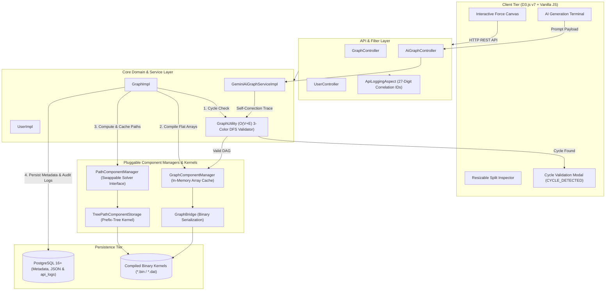

# Project Nexus (DAG Engine) — Enterprise Workflow Engine & Graph Processing Platform

[](https://openjdk.org/)
[](https://spring.io/projects/spring-boot)
[](https://www.postgresql.org/)
[](https://www.docker.com/)
[](https://deepmind.google/technologies/gemini/)
[](https://d3js.org/)
[](http://localhost:8091/swagger-ui/index.html)

---

## 🎬 Interactive UI Walkthrough & Demo

[](https://youtu.be/hIkw_Fb5ZgA)

> ### 🎥 [**Watch the End-to-End Interactive UI Walkthrough on YouTube**](https://youtu.be/hIkw_Fb5ZgA)
>
> *End-to-end demonstration showcasing AI prompt-to-graph synthesis with self-correcting validation, live D3.js canvas editing, O(V+E) cycle detection (`CYCLE_DETECTED`), multi-dimensional cost routing, and array-backed prefix-tree path calculation.*

---

## 📖 Overview

**Project Nexus (DAG Engine)** is a modular, high-performance **Directed Acyclic Graph (DAG)** workflow and route-optimization backend built with **Java 17/21**, **Spring Boot 3.x**, **PostgreSQL**, **Google Gemini AI**, and a **D3.js v7** interactive interface. It models complex dependency pipelines, state transitions, and multi-dimensional cost routing across arbitrary workflow domains.

### The Problem It Solves
Conventional Java graph libraries rely on deeply nested object graphs (`Map<Node, List<Edge>>`) that incur heavy heap allocation overhead, pointer indirection, CPU cache misses, and Garbage Collection (GC) pauses during large traversals. Unvalidated cyclic edits also cause infinite recursion and `OutOfMemoryError: Java heap space` crashes.

**Project Nexus** solves these bottlenecks at both the data-structure and architecture levels:
1. **Primitive Array Memory Layout:** Compiles workflow topologies into flat, contiguous primitive arrays (`int[]`, `float[]`), eliminating JVM object bloat and maximizing CPU L1/L2 cache locality.
2. **Array-Backed Prefix-Tree Path Kernel:** Pre-computes valid start-to-goal routes once and indexes them in `TreePathComponentStorage` for sub-millisecond cumulative cost queries.
3. **$O(V + E)$ Cycle Guard & Pre-Controller Validation:** Intercepts invalid or cyclic graph payloads (`CYCLE_DETECTED / HTTP 422`) *before* persistence or path computation, guaranteeing zero runaway recursion.
4. **Decoupled Interface-Driven Architecture (OOP & Dependency Injection):** Strict interface contracts between Controllers, Domain Services, and Swappable Component Managers allow alternative traversal solvers (e.g., 3-color DFS, Kahn's topological sort, or bounded lookahead solvers) to be swapped cleanly via Spring DI.
5. **AI Prompt-to-Graph Self-Correction Loop:** Converts natural-language workflow descriptions into structured DAG JSON and automatically feeds validation errors back to Gemini in a reflection loop until a valid topology is produced.

---

## ✨ Key Engineering Highlights

### 🧱 1. Interface-Driven Modularity & Swappable Solvers (OOP / Strategy Pattern)
* Strict module isolation across `Controller` $\to$ `Service Interface / Impl` $\to$ `ComponentManager` kernels using **Spring Dependency Injection**.
* Traversal and path-ranking modules adhere to a clean solver interface, enabling pluggable evaluation algorithms without modifying REST endpoints or persistence layers.

### 🛡️ 2. $O(V + E)$ 3-Color DFS Cycle Guard (`CYCLE_DETECTED`)
* Classifies graph vertices into `UNVISITED (0)`, `VISITING (1)`, and `VISITED (2)` to catch self-loops, 2-node cycles, and deep multi-component cycles in $O(V + E)$ linear time.
* Validates graph invariants *before* persisting state or triggering recursive path expansion, returning standardized `CYCLE_DETECTED` (`422 Unprocessable Entity`) validation responses with actionable cycle-breaking details in the UI modal.

### 🧭 3. Flat Primitive Kernel & Sub-Millisecond Routing
* **`GraphComponentManager` & `GraphBridge`:** Bakes JSON topologies into contiguous `int[]`/`float[]` blocks and persists compiled binary snapshots (`*.bin` / `*.dat`) alongside raw metadata in **PostgreSQL**, avoiding repeated expensive multi-table joins on reads.
* **`TreePathComponentStorage`:** Indexes all valid source-to-terminal paths and aggregates cumulative weights across dynamic cost dimensions (`time`, `cost`, `latency`, `risk`) in sub-millisecond read times.

### 🤖 4. AI-Powered Workflow Synthesis & Reflection Self-Repair
* **`GeminiAiGraphServiceImpl`:** Generates structured DAG payloads from plain English workflow prompts (e.g., CI/CD pipelines, approval flows, or state-action transitions).
* **Automated Reflection Loop:** If generated output violates DAG constraints or schema integrity, the engine catches the validation exception and passes the exact error trace back to Gemini to repair the topology before storage.

### 📊 5. Observability, AOP Correlation Tracing & D3.js Canvas
* **End-to-End Request Tracing (`ApiLoggingAspect`):** Intercepts API calls via Spring AOP, attaches a **27-digit chronological correlation ID** (`yyyyMMddHHmmssSSS` + 10-digit sequence), and persists audit telemetry to PostgreSQL (`logs.api_logs`).
* **Interactive D3.js v7 Canvas:** Hardware-accelerated force-directed SVG graph with drag-and-drop pinning, zoom/pan, dynamic cost parameter controls, and visual path highlighting.

---

## 🏛️ System Architecture



---

## 🛠️ Technology Stack

| Layer | Technologies | Purpose |
| :--- | :--- | :--- |
| **Backend** | **Java 17 / 21**, **Spring Boot 3.x**, **Spring AOP** | High-throughput REST APIs, dependency injection, cross-cutting telemetry |
| **AI Integration** | **Google Gemini API** | Natural-language DAG generation with schema/cycle self-repair |
| **Persistence** | **PostgreSQL 16+**, **Spring Data JPA / Hibernate** | Workflow metadata, JSON payloads, user accounts, and `logs.api_logs` |
| **Visualization** | **D3.js v7**, **HTML5 / CSS3** | Force-directed interactive graph UI and live route cost highlighting |
| **API Docs & Build** | **OpenAPI 3.0 (Swagger UI)**, **Maven (`mvnw`)**, **Docker** | Interactive API contracts, reproducible builds, and containerized setup |
| **Testing** | **JUnit 5**, **Mockito** | Automated verification of DAG validation, cycle guards, and correlation IDs |

---

## 🚀 REST API Reference

Interactive Swagger documentation is available locally at `http://localhost:8091/swagger-ui/index.html`.

| Category | Method & Endpoint | Description |
| :--- | :--- | :--- |
| **AI Synthesis** | `POST /workflow-engine/ai/generate` | Generates and validates a DAG from a natural language prompt with self-repair. |
| **Graph Lifecycle** | `POST /workflow-engine/graphs/upload` | Validates acyclicity, compiles flat array kernel, and persists to PostgreSQL & binary store. |
| **Graph Update** | `POST /workflow-engine/graphs/update` | Updates metadata or triggers topology recompilation with $O(V+E)$ cycle validation. |
| **Graph Retrieval** | `POST /workflow-engine/graphs/get` | Loads graph into active in-memory kernel and returns visualization payload. |
| **Evict / Delete** | `POST /workflow-engine/graphs/close` \| `delete` | Evicts graph from active memory or removes from DB (guarded against active deletion). |
| **Path Routing** | `POST /workflow-engine/graphs/paths` \| `GET /{id}/paths` | Computes valid start-to-goal routes with cumulative multi-dimensional cost breakdowns. |
| **User Accounts** | `POST /workflow-engine/user/create` \| `validate` \| `get` \| `delete` | Manages user accounts and associated workflow catalogs. |

---

## 🧪 Testing & Verification

Run the automated test suite using the Maven Wrapper:

```bash
./mvnw test
```

### Verified Test Coverage
* **`GraphUtilityTest`:** Validates linear DAGs, diamond DAGs, self-loops, 2-node cycles, multi-node loops, and disconnected cyclic topologies.
* **`CorrelationIdGeneratorTest`:** Verifies chronological uniqueness and thread-safe 27-digit sequence generation.
* **Active Memory Guard & Path Tree Verification:** Ensures active in-memory topologies cannot be deleted mid-read and validates exact path cost aggregation.

---

## 💻 Getting Started

### Option 1: Docker Compose (Recommended)
```bash
cp .env.example .env
docker compose up --build
```

### Option 2: Run Locally with Maven Wrapper
**Prerequisites:** JDK 17+, PostgreSQL 16+, Git

1. Create the database:
   ```sql
   CREATE DATABASE dag_nexus_db;
   ```
2. Configure environment variables (`cp .env.example .env` or `application-local.properties`).
3. Start the Spring Boot backend:
   ```powershell
   .\mvnw.cmd spring-boot:run
   ```
4. Open **`http://localhost:8091`** in your browser.

---

## 📄 License
Licensed under the Apache-2.0 License.
